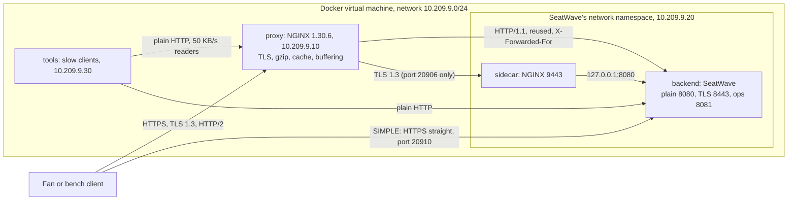

# Architecture

## Packages

All code is under `io.plainround.seatwave.proxy`, one package per feature:

| Package | What it holds | Depends on |
|---|---|---|
| `forwarded` | The client-address rule: `ClientAddress`, `TrustedProxies`, `ClientView`, `ForwardedHeaders`, `AddressSource` | the JDK only |
| `backend` | SeatWave: `BackendServer` (the JDK's HTTP and HTTPS servers, a fixed pool of 64 workers, an operations listener), `SeatWaveRoutes`, `SeatCatalog`, `HoldLedger`, `HoldKeys`, `StaticFiles`, `BackendMetrics`, `BackendSettings`, `BackendCli` | `forwarded`, `config`, `tls`, `json` |
| `bench` | The load bench: `LoadRun` (closed loop, reused or new connections), `RawResponse`, `ContainerCounters` (`docker exec ... cat cpu.stat /proc/net/snmp`), `BenchReport`, `BenchCli` | `config`, `tls`, `report` (`Runs`) |
| `probe` | The outage probe: `ProbeCli`, `Outcome`, `Timeline` | `config`, `tls` |
| `slow` | The slow clients: `SlowClients`, `SlowSettings`, `SlowResult`, `SlowClientsCli` | `config` |
| `logs` | The proxy's access log: `AccessLine`, `LogStats`, `LogStatsCli` | the JDK and result4j |
| `report` | Module 5's `curl -w` report, unchanged but for the package and the removed Java reuse table | the JDK and result4j |
| `config`, `tls`, `json` | `SettingsReader` and `SettingsFiles`; `TlsFiles`; `JsonCodec` (Module 7's) | the JDK, result4j, Jackson |

**The dependency rule.** `forwarded` depends on nothing of this project, so the invariant can be read and tested alone. The tools (`bench`, `probe`, `slow`, `logs`, `report`) never depend on `backend`; they talk to it over HTTP like any client. Only the `*Cli` classes print or exit, and each has a `run` or `start` method that the tests call.

## Data flow

## Walk-throughs

**A seat map through PRODUCTION.** The fan's TLS 1.3 handshake ends at NGINX (`tls.conf`). The request matches `location /` in `production.conf`; the cache is looked up and misses, because SeatWave marks the seat map `no-cache`. NGINX sends the request on a reused upstream connection with `proxy-headers.conf`'s headers. `BackendServer.handle` takes a worker, `request()` decides the client with `ClientAddress.resolve`, `SeatWaveRoutes.route` builds the 36,894-byte map, and `writeBody` hands it to NGINX at network speed. NGINX compresses it (gzip level 1) and writes it to the fan at the fan's speed.

**A forged address.** A client sends `X-Forwarded-For: 203.0.113.7` straight to SeatWave's port. `ClientAddress.resolve` sees that the peer is not in `TrustedProxies` and returns the peer with `AddressSource.PEER`; `BackendServer` counts the ignored header. Through the proxy, `proxy-headers.conf` has already replaced the header with `$remote_addr`, and written `Forwarded: for="10.209.9.1";proto=https` (an IPv6 client would be `for="[2001:db8::17]"`, the brackets added by the `map` in `nginx.conf`). An address is read only in its exact form: IPv4 as four decimal parts, IPv6 in brackets inside `Forwarded`; `127.1` or an unbracketed `2001:db8::1` makes the header unreadable, never another address.

**A bench row.** `BenchCli` reads both containers' counters, `LoadRun` runs 8 clients for 10 s, the counters are read again, and `BenchRow` turns the differences into CPU milliseconds per thousand requests sent, failed ones included, because a container spends CPU on those too. Three runs make a row; `BenchReport.median` prints the median by throughput, and a warning line under the row when more than 1 percent of its requests failed or its fastest run was more than twice its slowest. A counter that went down between two readings (the container restarted) stops the bench with exit status 1.

## Decisions and trade-offs

- **NGINX stable (1.30.6) from the Docker Official Image, pinned by digest.** The prompt names NGINX; stable over mainline for a production pattern. Its documentation showed that 1.29.7 changed upstream defaults (reuse on, HTTP/1.1), which the configuration now writes out.
- **A small backend, not Module 7's whole service.** The labs need SeatWave's paths and shapes, not its database and payments; holds live in memory, and the module says so where it matters.
- **Platform threads for SeatWave's workers.** A fixed pool of 64 makes the cost of a slow client visible as a busy worker, which is what buffering removes; virtual threads would hide it as memory instead.
- **An operations listener on its own thread.** `/metrics` must answer while every worker is busy, or the slow-client lab cannot see the workers.
- **`TCP_NODELAY` on SeatWave's connections.** The JDK server's default (`sun.net.httpserver.nodelay=false`) let Nagle's algorithm hold each response body about 40 ms on the sidecar's loopback link; the image turns it on.
- **The Java bench, not k6.** It needs only the JDK, reads each container's CPU from its control group, and can open a new TLS connection per request.
- **The slow clients inside the lab network.** Docker Desktop's port forwarder buffers responses on its own; from the Mac it would hide what proxy buffering does.
- **A second NGINX as the sidecar, in SeatWave's network namespace.** It shows the shape (loopback to the service, TLS on the inside link, shared fate) without a service mesh.
- **Configuration rules as a unit test.** `NginxConfigRulesTest` keeps the proxy's half of the invariant in `./gradlew check`, without Docker.
- **HTTP methods as RFC 9110 defines them.** `HEAD` is answered like `GET` with no body; a known path answers another method with `405` and an `Allow` header (`GET, HEAD`, or `POST` for `/v1/holds`); an unknown path is `404` for every method.
- **Settings paths may hold any character but a control character.** A reader's checkout can sit in a deep folder or one with a space; `SettingsReader.filePath` allows up to 4,096 characters, Linux's longest path.

## Invariants and where they are enforced

| Invariant | Enforced in | Tested by |
|---|---|---|
| SeatWave believes forwarded headers only from trusted addresses, read before any route | `ClientAddress.resolve`, called once in `BackendServer.request`; `TrustedProxies` holds addresses only | `ClientAddressTest`, `ForwardedInvariantTest`, `StackInvariantTest` |
| A forwarded or trusted address is read only in its exact form, or not at all | `ClientAddress.literal` and `nodeAddress`; the `map` in `nginx.conf` that brackets an IPv6 node | `ClientAddressTest`, `BackendSettingsTest`, `NginxConfigRulesTest` |
| The edge overwrites the client address, in every proxied location | `nginx/seatwave/proxy-headers.conf`, included in every location | `NginxConfigRulesTest`, `StackInvariantTest` |
| The proxy never caches a `POST` or a `private` response, and never serves stale | `proxy_cache_methods GET HEAD`; no `proxy_ignore_headers`, no `proxy_cache_use_stale`; SeatWave's `Cache-Control` on every reply | `NginxConfigRulesTest`, `StackInvariantTest` |
| A seat has at most one active hold | `HoldLedger.hold` with `ConcurrentHashMap.compute` per seat | `HoldLedgerTest` (100 racing threads) |
| The same Idempotency-Key and body get the same reply; another body is refused | `HoldKeys.claim` | `HoldKeysTest`, `BackendServerTest` |
| Every queue and table is bounded | the worker queue (`http.queueCapacity`), the key table (`HoldKeys.MAX_KEYS`), the hold table (at most one hold per seat: a new hold replaces the expired one) | `BackendServerTest`, `HoldKeysTest`, `HoldLedgerTest` |
| The proxy closes idle upstream connections before SeatWave does | `keepalive_timeout 20s` against the JDK's 30 s, in every upstream that keeps connections, in any time unit | `NginxConfigRulesTest` |
| Every port is on 127.0.0.1 in 20900 to 20999, every image pinned by digest, nothing privileged; each service publishes exactly the ports it listens on | `compose.yaml`, `Dockerfile` | `NginxConfigRulesTest` |
| Every bench, curl and slow-client row comes from at least 3 runs, or is refused | `Runs.requireEnough`, `BenchSettings` | `TimingReportTest`, `BenchReportTest` |
